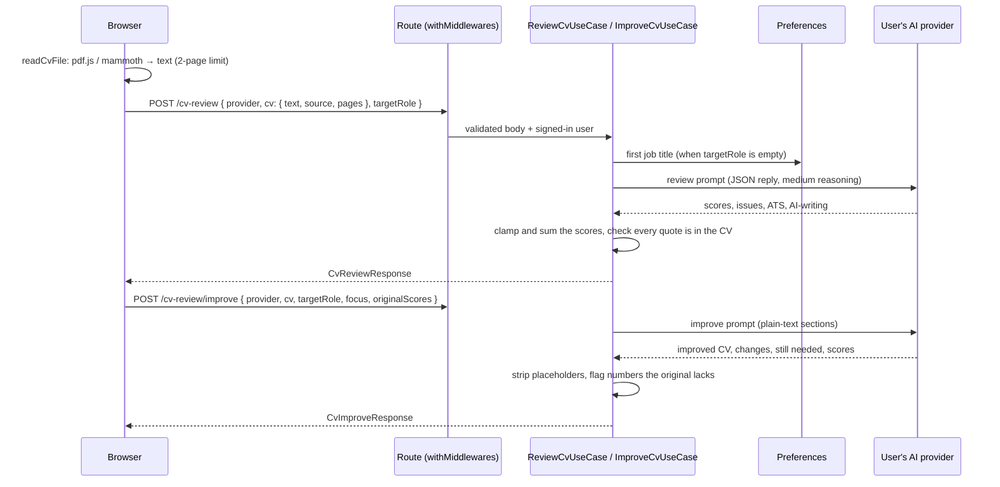

# CV review

`/dashboard/cv-review` scores a CV the way recruiters and ATS software read it,
explains what to fix, and writes an improved version with the user's own AI,
without inventing anything. It follows the CV review skill
([jobak-net/career-agent-skills](https://github.com/jobak-net/career-agent-skills),
`cv-review/`): its scorecard, its rules, and its two phases, review first and
improve when asked.

The tool reads files in the browser and talks to the AI factory like the
cover letter does ([COVER_LETTER.md](COVER_LETTER.md),
[AI_PROVIDERS.md](../backend/AI_PROVIDERS.md)).

## What the user does

1. Opens the page. Without a saved AI key it's locked behind `AiToolGate`.
2. Adds the CV, in one of three ways:
   - **Saved**: one of their saved CVs (see "Saved CVs and name"). This is the
     default when they have one, with the most recently used selected.
   - **Upload**: a PDF or Word (.docx) file, read into text in the browser. The
     file is never uploaded. A PDF over **2 pages** is refused with a message
     saying so (see "Reading files" below).
   - **Paste**: the text itself.

   Every way, the text is shown in an editable field, "What the AI will read".
   For a file, that's also what an ATS extracts, so the user can fix what
   came out wrong.
3. Checks the **target role**, filled in from the first job title in
   Preferences. Empty means "judge it on its own direction".
4. Presses **Review my CV**, picks a saved key in the popup and confirms.
5. Gets the review:
   - the score out of 100 and its rating;
   - the career level it reads as;
   - the overall assessment and the first 10-second impression;
   - the score by category;
   - what works and what holds it back;
   - **what to fix**: each issue with the CV's own words quoted, why it
     matters, a suggestion, and a priority;
   - **See them in your CV**: the CV with those passages highlighted and
     numbered;
   - the **ATS check**: six checks, plus keywords found and missing for the
     target role;
   - **Does it read as AI-written?**: a rating, phrases with plainer
     alternatives, and the shared word check (`findAiTells`).
6. Presses **Write the improved CV** (same provider, no popup). The button
   isn't offered when there's nothing to fix: a score of 100, or a review with
   no issues, shows "Nothing to improve" (a rewrite could only lose points).
   From 90 up it says a rewrite may not raise the score. The user gets:
   - the scores before and after;
   - what changed;
   - what only they can add;
   - the improved CV, editable, with Copy, PDF and Word.

   Numbers the original doesn't contain, and wording that reads as generated,
   are flagged live as they edit.

## Saved CVs and name

The name and CV are asked once and kept for every AI tool. Both are stored in
Postgres (migration `025_applicant_cvs.sql`), as text only: there's no file
storage.

| What | Where | How it's filled |
|---|---|---|
| The name on applications | `user_preferences.applicant_name` (not `users.full_name`, which Clerk overwrites on every sync) | the cover letter saves it when the user changes the name and writes a letter. Every tool's name default is it, else the account's name |
| Their CVs | `user_cvs`: label, text, source, PDF pages, a SHA-256 of the text | the CV a tool runs on is saved: CV review on Review. Uploading or pasting is enough; the same text again only moves it to the top |

- **The 5 most recently used are kept.** Saving prunes the rest in the same
  transaction.
- **Each text is stored once per user** (unique on the hash). Its label stays
  as first saved. An edited saved CV is a new text, labelled "… (edited)".
- **The user can delete any of them** from the picker, after confirming in
  place. Rows go with the account (`ON DELETE CASCADE`), and the table is
  locked to the app's own connection (RLS on, browser roles revoked).

The tools:
- **CV review:** offers a **Saved** option, the default when there's one.
- **Cover letter:** "What you've done" starts from the latest saved CV, with
  a **Start from** picker for another, or none.
- **CV tailoring:** the same CV input as CV review, saved when the analysis
  runs ([CV_TAILOR.md](CV_TAILOR.md)).

**Dashboard step 3** is "Upload your CV". It's ticked once the user has a
saved CV, from whichever tool.

| Endpoint | Does |
|---|---|
| `GET /api/v1/applicant` | the name (or null) and the CVs, most recently used first |
| `PUT /api/v1/applicant/name` | saves the name (404 before onboarding: there's no preferences row to hold it) |
| `POST /api/v1/applicant/cvs` | saves a CV, or moves the same text to the top |
| `DELETE /api/v1/applicant/cvs/[id]` | deletes one of the user's CVs (404 for anyone else's) |

Contract: `src/shared/contracts/applicant.ts`.

- **Backend:** `src/backend/modules/applicant/` (use cases,
  `PgApplicantRepository`, schemas).
- **Frontend:** `ai-tools/api/applicant.*`, `ai-tools/shared/hooks/use-saved-cvs.ts`
  and `ai-tools/shared/components/saved-cv-picker.tsx`.
- **Writes:** limited by the `applicant` policy, 30 a minute per user.
- **Saving runs in the background.** The tool's request doesn't wait for it,
  and a failure is logged (the message, never the CV), not shown.
- **Before migration 025 runs,** the reads fail softly: the tools ask for the
  name and CV as before, and the step stays unticked.

## Use in your own AI

The header's **Use in your own AI** opens the CV review skill with its version
dropdown, Copy and Download, as on the cover letter page (`SkillButton`,
`GET /api/v1/ai-tools/skills/cv-review`). The skill lives in the skills
repository, read from GitHub ([COVER_LETTER.md](COVER_LETTER.md#use-in-your-own-ai)).

## How it flows



The server keeps nothing between the two requests: the page sends the CV, the
review's findings (`focus`) and its scores back with the second one.

## Code map

```
src/shared/
├── contracts/cv-review.ts           both endpoints, CV_CATEGORIES (the scorecard), limits, ratings
└── ai-tools/cv-text.ts              findQuote (loose quote matching), restoreContactDetails, unsupportedNumbers

src/backend/modules/ai-tools/
├── shared/application/
│   ├── complete-with-retry.ts       one retry when the provider throttles (also used by the cover letter)
│   └── token-budget.ts              replyCeiling: input + ceiling under a free tier's minute
└── cv-review/
    ├── application/review-cv.use-case.ts
    ├── application/improve-cv.use-case.ts
    ├── domain/cv-review-prompt.ts   both prompts, readReviewReply, readImproveReply
    └── validation/                  cv-input-schema, cv-review-schema, cv-improve-schema

src/app/api/v1/(ai-tools)/ai-tools/cv-review/route.ts          POST review
src/app/api/v1/(ai-tools)/ai-tools/cv-review/improve/route.ts  POST improve

src/frontend/modules/ai-tools/
├── shared/                          used by CV review and CV tailoring
│   ├── lib/read-cv-file.ts          PDF / Word → text, in the browser
│   ├── hooks/use-cv-input.ts, components/cv-input.tsx, cv-file-input.tsx   the CV: saved / upload / paste
│   ├── components/cv-editor.tsx, score-comparison.tsx   the rewritten CV and its scores
│   └── lib/export-document.ts, hooks/use-document-export.ts   PDF / Word (also the cover letter)
└── cv-review/
    ├── api/            cv-review.api, cv-review.mutations, cv-review.loader
    ├── hooks/use-cv-review.ts       the tool's state (the CV from useCvInput)
    ├── lib/highlights.ts            segmentsFor: the marked-up CV
    ├── components/     cv-review-tool, cv-review-form, review-overview,
    │                   review-findings, review-ats, improved-cv
    └── views/cv-review-view.tsx
```

## The API

Contract: `src/shared/contracts/cv-review.ts`. Both endpoints need a signed-in
user and share one rate limit (`ai-tools.cv-review`, 6 a minute per user).

```ts
// POST /api/v1/ai-tools/cv-review
{ provider: "groq", cv: { text: "…", source: "pdf", pages: 1 }, targetRole: "Frontend Engineer" }
// → { score: 71, rating: "good", categories: [{ id, label, score, max, feedback }×8],
//     summary, firstImpression, careerLevel, strengths, weaknesses,
//     issues: [{ quote | null, issue, why, suggestion, priority: 1 | 2 | 3 }],
//     ats: { checks: [{ label, status: "pass" | "warn" | "fail", detail }], keywordsFound, keywordsMissing },
//     aiWriting: { rating, note, phrases: [{ quote, alternative }] }, targetRole, provider, model }

// POST /api/v1/ai-tools/cv-review/improve
{ provider, cv, targetRole, focus: ["…"], originalScores: { summary: 6, … } }
// → { cv, changes, stillNeeded, score, categories, unsupportedNumbers, provider, model }
```

| Status | Code | When |
|---|---|---|
| 400 | `validation` | CV text under 200 or over 10,000 characters, more than 2 pages, a bad provider |
| 409 | `ai-not-connected` | no saved key for that provider |
| 422 | `ai-key-rejected` / `ai-model-unavailable` | the provider refused the key, or retired the model |
| 429 | `rate-limited` / `ai-provider-limited` | our limit, or the provider's (retried once when it asks to wait 20 s or less) |
| 503 | `service-unavailable` | the provider failed, or the reply had no usable review or CV |

## Reading files in the browser

`ai-tools/shared/lib/read-cv-file.ts` (shared with CV tailoring). Nothing is uploaded: the server only ever receives text.

| File | How | Refused when |
|---|---|---|
| PDF | pdf.js (`pdfjs-dist` 6.5.438), **legacy build** | over **2 pages** ("Your CV has 3 pages. Keep it to 2 pages at most…"), password-protected, unreadable, or no text in it (a scan, which ATS software can't read either) |
| Word (.docx) | mammoth 1.13.0, raw text | unreadable. Word doesn't record a page count reliably, so the 10,000-character limit bounds it instead |
| Old .doc, anything else | | always: "Save it as .docx or PDF, or paste the text" |

- Both libraries load only when a file of their kind is chosen (`import()`).
- **Legacy pdf.js build.** The modern build calls `Uint8Array.prototype.toHex`,
  which a recent Chrome still lacked in testing ("toHex is not a function").
  The legacy build polyfills it.
- **Worker.** pdf.js's worker module is imported into the page
  (`globalThis.pdfjsWorker`) rather than run as a separate worker file. A
  two-page CV parses in about 0.3 s, and nothing depends on how a bundler
  handles worker URLs.
- **mammoth** is CommonJS, so a dynamic import returns it under `default` in
  some bundlers. The code takes either.
- **Over 5 MB** is refused before reading.

## Scoring

The skill's eight categories and weights (`CV_CATEGORIES`):

| Category | Max |
|---|---:|
| Professional summary | 10 |
| Work experience | 20 |
| Achievements and impact | 15 |
| Skills | 15 |
| ATS compatibility | 10 |
| Structure and readability | 10 |
| Language | 10 |
| Completeness | 10 |

`readReviewReply`:
- clamps each category to its range;
- sets the total to their sum, so it always adds up, with the rating from
  the skill's ranges (`cvRatingFor`);
- looks every quote up in the CV (`findQuote`, which ignores spacing, quote
  marks, dash kinds and case):
  - an issue whose quote isn't there keeps its text but loses the highlight;
  - an AI-writing phrase that isn't there is dropped.

The review runs at temperature 0.3, for steadier scores, but runs still
differ: the same CV scored 81 and 71 in two live runs. So the improved CV
isn't re-scored from scratch. The improve request carries the review's scores
as a baseline, and a category moves only by what the changes are worth.

The page says the score is an evaluation framework, not a real ATS score, as
the skill asks.

## The improved CV

The rules, from the skill and from what live runs got wrong:
- change only what the review flagged; every other part stays word for word.
  A user's 100-point CV came back at 97 when the whole thing was reworded;
- if the model's version of a part is weaker than the original, it keeps the
  original wording: the improved CV is never to be worse in any category;
- keep every employer, title, date, degree and link;
- copy the name and contact details character for character. A run replaced
  a user's `@aol.com` with `@<personal-domain>.com`: advice about an email
  domain belongs in the review, never in the CV;
- invent nothing (experience, metrics, skills, dates);
- reword and restructure, but don't add detail: no new causes, scopes,
  results, teams or tools. Live runs added "ensuring cross-browser
  compatibility" and "for regression testing";
- never state a total number of years. A run wrote "over 3 years" for a CV
  whose dates say about five;
- no empty sections or placeholders: what's missing goes under "Still
  needed";
- plain text, standard headings, "- " bullets, no markdown or em dashes;
- about the same length as the original, never over two pages.

The reply is plain text in `=== IMPROVED CV === / CHANGES / STILL NEEDED /
SCORES ===` sections, not JSON: a long CV in a JSON string is what Groq's
JSON mode refused for cover letters. `readImproveReply`:
- removes stray markdown;
- removes placeholder lines, and a section left empty without them;
- parses the scores.

Contact details are then put back whatever the model did
(`restoreContactDetails`, `src/shared/ai-tools/cv-text.ts`):
- an email the original doesn't have becomes the original email with the
  same name before the "@" (or the original's only email);
- a link to the same site with a different path becomes the original link;
- a line with a template slot such as `<your-portfolio-url>` is removed.

What was put back is logged by kind only (`[cv-review] contact details put back: email, link`): the details themselves never go in a log.

The server then lists numbers in the improved CV that the original lacks
(`unsupportedNumbers`), and the page re-checks that and `findAiTells` as the
user edits.

When the rewrite still scores lower than the original overall, or in any
category, the page says so plainly:
- "The rewrite scored lower than your original (90 against 95), so it isn't an
  improvement";
- it names the categories where the original is better and shows them in red;
- it tells the user to keep their original and take only the changes they
  like.

The scores aren't clamped to hide it.

Review suggestions also never carry made-up figures. A live run suggested
"Resolved 30+ UI bugs, reducing support tickets by 15%"; now they say what to
add ("how many pages you built, if you know").

The improved CV is saved in the same ATS-friendly design as the tailored CV,
with the same Edit / Preview switch ([CV_TAILOR.md](CV_TAILOR.md#the-cv-as-a-file)).

## Free-tier limits

Groq's free tier allows 8,000 tokens a minute on GPT-OSS and appears to count
the reply ceiling up front.
- **Sized ceiling.** `replyCeiling` sizes each request's ceiling to its input
  (review: up to 3,500; improve: up to 4,000; never under 2,500 / 3,000).
- **Retries.** A reply that thinks through its whole ceiling is retried once
  at low reasoning. A throttled call is retried once.
- **Two separate requests.** Review and improve are separate, which keeps
  each inside the minute. The page notes that a free tier may need a minute
  between them.

Measured on GPT-OSS 120B, 2026-11-23:
- review: about 1,400–1,600 tokens in, 2,200–2,600 out;
- improve: about 1,450–1,600 tokens in, 1,500–2,200 out.

## Testing

No test runner yet. Checked with `tsx` scripts and a browser harness:
- **Reading files**, in Chrome, through the real `readCvFile`:
  - a 1-page PDF reads (1,250 characters, 0.3 s);
  - a 3-page PDF gets the page-limit message;
  - an image-only PDF gets the scan message;
  - a .docx reads;
  - a .doc gets refused.
- **The page**, the real components rendered with the live replies:
  upload → extracted text → popup → review (every section, highlights) →
  improve (before and after, changes, flags). The request bodies were checked:
  source, pages, focus, original scores.
- **The readers**:
  - placeholder sections removed;
  - out-of-range scores clamped;
  - loose quotes found and invented ones rejected;
  - JSON wrapped in prose or code fences parsed;
  - trailing commas tolerated;
  - invented numbers ("3 years", "5,000 users") flagged.
- **Live**, Groq GPT-OSS 120B, a sample CV: the review, then the improvement.
