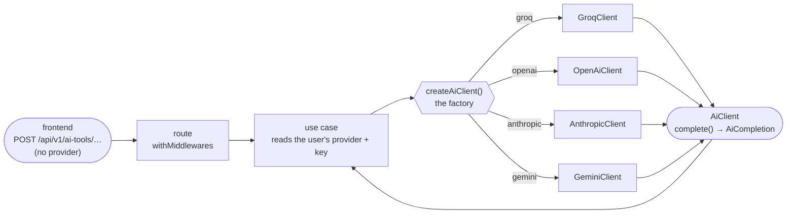

# AI providers: the client factory

Users run Jobak's AI on their own key, with the provider they picked in
onboarding or Settings: Groq, Google Gemini, OpenAI or Claude. The rest of the
app must not care which one it is. The AI tools' endpoints don't take a
provider, the frontend never sends one, and a use case never branches on one.
The **AI client factory**, in the integrations module
(`src/backend/modules/integrations/ai/`), is the only code that knows the
difference. Other modules import it from the module's entry,
`@/backend/modules/integrations`, and never from a file inside.

```ts
import { createAiClient } from "@/backend/modules/integrations";

const ai = await createAiClient({ provider: "groq", apiKey, rateLimitKey: user.id });
const { text } = await ai.complete({
  system: "You review CVs…",
  messages: [{ role: "user", content: cvText }],
  responseFormat: "json",
});
```

Swap `"groq"` for `"anthropic"` and nothing else changes.

## Who knows what



| Layer | Knows | Doesn't know |
|---|---|---|
| Frontend | the tool's endpoint and its contract (`src/shared/contracts/`) | which provider, which model, the key |
| Route | auth, validation, the use case to call | anything AI |
| Use case | the prompt, the reply's shape, the user's provider id, model and key | how that provider is called |
| Factory | which class serves which id | prompts, users, tools |
| Provider client | its own API: URL, headers, body, response, errors | anything else |

## The pattern

It's a **factory with a registry**. A **template method** in the base class holds
the steps every provider shares.

| Role | In the code |
|---|---|
| Product (the interface callers use) | `AiClient`, in `ai/domain/ai-client.ts` |
| Concrete products | `GroqClient`, `OpenAiClient`, `AnthropicClient`, `GeminiClient`, in `ai/infrastructure/providers/` |
| Factory | `createAiClient(options)`, in `ai/ai-client.factory.ts` |
| Registry | `PROVIDERS`: provider id → a loader that imports that client |
| Template method | `BaseAiClient.complete()` runs the shared steps; each client implements only `send()` |

Three properties come from this:

1. **One place decides.** `PROVIDERS` is the only mapping from an id to a class.
   No `switch (provider)` anywhere else.
2. **Only what's picked is loaded.** Each registry entry is a dynamic `import()`,
   so a Groq request never loads Claude's integration.
3. **The compiler checks completeness.** The registry is typed
   `Record<AiProviderId, …>`, and `AiProviderId` comes from the one shared list
   (`AI_PROVIDER_IDS` in `src/shared/ai/`). The build fails if an id is missing
   from the registry, the model list, the defaults or the rate-limit policies,
   and also if one of them has an id that isn't in the list. A default that
   isn't on its provider's model list is a build error too.

### What `complete()` does

```
BaseAiClient.complete(request)
  1. at least one message, or InternalServerError
  2. enforceRateLimit("<provider>", rateLimitKey)          our limit, per user
  3. fill in maxTokens; in JSON mode add the JSON instruction to the system prompt;
     leave out temperature for a model that only takes its own (fixedTemperature)
  4. send(request)                                          ← the provider's class
       translate to its API → callProvider() → translate the answer back
```

`callProvider()` (`http.ts`) makes the one HTTP call. It applies the timeout
and turns every failure into one of our exceptions, so all four providers fail
in the same way.

## Files

```
src/shared/ai/providers.ts            AI_PROVIDER_IDS, the one list (frontend and backend)
src/shared/ai/models.ts               AI_MODELS (the models a user may pick) and AI_DEFAULT_MODELS
src/shared/contracts/ai-settings.ts   GET/PUT /api/v1/ai-settings, PUT /api/v1/ai-settings/key
src/shared/credentials/key-rules.ts   what each provider's keys look like (browser and API)
src/backend/shared/crypto/            encryptSecret / decryptSecret (AES-256-GCM, ENCRYPTION_SECRET)
db/supabase/024_ai_models.sql         user_preferences.ai_models

Kept in the shared places every module uses, not in the integrations module:
  src/shared/errors/error-codes.ts                ai-key-rejected, ai-provider-limited
  src/backend/shared/exceptions/types/            AiKeyRejectedError, AiProviderLimitedError
  src/backend/shared/rate-limit/policies.ts       groq, gemini, openai, anthropic

src/backend/modules/integrations/
├── index.ts                          the module's entry: createAiClient, getIntegrationsModule, the types
├── composition.ts                    the use cases, built once per process
└── ai/
    ├── index.ts
    ├── ai-client.factory.ts          the registry and createAiClient()
    ├── config.ts                     resolveModel(): the pick, AI_MODEL_<PROVIDER>, the default; AI_TIMEOUT_MS
    ├── application/
    │   └── ai-settings.use-cases.ts  Get/SetModel/ConnectKey/RemoveKey/SetPreferred, CreateAiClientForUser
    ├── domain/
    │   ├── ai-client.ts              AiClient (the port) and its request/response types
    │   └── ai-settings.repository.ts where the picks are kept (port)
    ├── validation/
    │   ├── ai-model-schema.ts        PUT body: a provider and a model on its list
    │   ├── ai-key-schema.ts          PUT /key body: a provider and a value shaped like its keys
    │   ├── ai-provider-params-schema.ts  DELETE /key/[provider]: the [provider] segment
    │   └── preferred-provider-schema.ts  PUT /preferred body
    └── infrastructure/
        ├── base-ai-client.ts         the template: rate limit, defaults, JSON mode
        ├── http.ts                   callProvider(): timeout, provider errors → exceptions
        ├── pg-ai-settings.repository.ts   user_preferences: ai_providers, ai_keys_encrypted, ai_models
        └── providers/
            ├── openai-compatible.client.ts   Chat Completions, shared by OpenAI and Groq
            ├── openai.client.ts
            ├── groq.client.ts
            ├── anthropic.client.ts           Messages API
            └── gemini.client.ts              generateContent
```

No SDKs: each provider is one `fetch`, so there are no dependencies to keep up
to date. A provider can switch to its SDK inside its own `send()` without
anything else changing. Because the registry loads clients lazily, a heavy
SDK is only loaded for the users of that provider.

## The interface

```ts
interface AiCompletionRequest {
  system?: string;                     // the tool's instructions
  messages: AiMessage[];               // { role: "user" | "assistant", content }
  responseFormat?: "text" | "json";    // json: one JSON object back
  maxTokens?: number;                  // default 4096
  temperature?: number;                // provider default when unset
  reasoning?: "low" | "medium" | "high"; // reasoning models only (`reasoningEffort` in AI_MODELS: GPT-OSS)
  signal?: AbortSignal;                // cancel; a timeout applies regardless
}

interface AiCompletion {
  text: string;
  finishReason: "stop" | "length" | "other";
  provider: AiProviderId;              // for logs and usage, never to branch on
  model: string;
  usage: { inputTokens: number; outputTokens: number } | null;
}

// and, on AiClient:
verifyKey(): Promise<void>;            // free check: the provider's model list
```

**JSON mode** uses the provider's own feature where it has one: OpenAI's and
Groq's `response_format`, Gemini's `responseMimeType`. In every case, Claude
included, it also adds an instruction to the system prompt. No provider
guarantees the *shape* of the JSON, so the use case still parses the reply
with a Zod schema and treats a mismatch as a failure.

**Reasoning effort.** `reasoning` is sent as `reasoning_effort` only to
models marked `reasoningEffort` in `AI_MODELS` (Groq documents it for GPT-OSS
20B and 120B: `low`, `medium`, `high`); every other model never gets it, since
providers refuse parameters a model doesn't take. On a free tier it decides how
far the per-minute token limit goes.

Use JSON mode for data, not prose. Groq checks the reply against JSON itself
and refuses it with a 400 `json_validate_failed` when the model's JSON is
broken. With a long letter in a string (line breaks, quotes) that happened on
gpt-oss, with an empty `failed_generation`. The cover letter asks for plain
text for this reason ([COVER_LETTER.md](../ai-tools/COVER_LETTER.md#what-the-ai-knows)).

## Errors

`complete()` throws only exceptions from `@/backend/shared/exceptions`. The
route's error handler answers with them, and the messages users read are in
`src/shared/errors/error-codes.ts`.

| What happened | Thrown | Status · code | Who fixes it |
|---|---|---|---|
| Over **our** limit for this provider | `TooManyRequestsError` | 429 · `rate-limited` | wait |
| The provider is **throttling the key** | `AiProviderLimitedError` (+ `Retry-After` if given) | 429 · `ai-provider-limited` | wait |
| The provider **refused the key** (401/403; Gemini's 400 `API_KEY_INVALID`) | `AiKeyRejectedError` | 422 · `ai-key-rejected` | the user: replace the key in Settings |
| The provider **doesn't offer the model** (404 / 400 "model not found", "decommissioned") | `AiModelUnavailableError`, logged | 422 · `ai-model-unavailable` | the user: pick another model in Settings; us: update `AI_MODELS` |
| **No usable key** for the user (`clientForUser`, `PUT /preferred`) | `AiNotConnectedError` | 409 · `ai-not-connected` | the user: add a key in Settings |
| Provider 5xx, timeout, unreachable, non-JSON answer | `ServiceUnavailableError` | 503 · `service-unavailable` | retry |
| Provider refused the **request** (another 4xx: unknown model, bad parameter) | `InternalServerError`, logged with the provider's answer | 500 · `internal` | us |

A rejected key is a 422, not a 401: the frontend reads a 401 as "signed out".
Nothing from the provider's answer reaches the client. `detail` names only the
provider and the status, and the key is never logged.

## Rate limits

Every call first counts against the provider's policy in
`src/backend/shared/rate-limit/policies.ts`, keyed by `rateLimitKey` (the user's
id). Each user brings their own key, so each user has their own quota. The
limits are set below each provider's lowest tier, so the user runs into our
limit, with a clear wait, before the provider's.

| Policy | Default |
|---|---|
| `groq` | 20 / minute |
| `gemini` | 8 / minute |
| `openai` | 30 / minute |
| `anthropic` | 30 / minute |

Override any of them per environment with `RATE_LIMIT_GROQ=40/1m` and so on,
or switch one off with `off` (see [RATE_LIMIT.md](RATE_LIMIT.md)).

## Models: the user's pick

Users choose the model in Settings, under the AI provider. The choice is kept
per provider, so switching from Groq to Claude and back keeps the Groq pick.

**The list.** `AI_MODELS` in `src/shared/ai/models.ts` holds three or so
models per provider, each with a label, a one-line note and, when needed,
`fixedTemperature`. Both sides read it: Settings shows it, and the backend
accepts nothing else. It's curated rather than fetched from each provider,
because their own lists change without notice and include models the tools
can't use.

| Provider | Default (`AI_DEFAULT_MODELS`) | Also on the list | No `temperature` sent |
|---|---|---|---|
| Groq | `openai/gpt-oss-120b` | `openai/gpt-oss-20b`, `qwen/qwen3.8-27b` (preview on Groq) | |
| Gemini | `gemini-3.8-flash` | `gemini-3.6-flash`, `gemini-3.5-flash-lite` | |
| OpenAI | `gpt-6-luna` | `gpt-6.1-terra`, `gpt-6.2-sol` | all |
| Claude | `claude-sonnet-5-5` | `claude-opus-5-5`, `claude-haiku-5-5` | all |

Last checked against each provider's models and deprecations pages on
**2026-11-22**. Retired since the first list:

| Model | What the provider says | Replaced by |
|---|---|---|
| Groq `llama-3.3-70b-versatile`, `llama-3.1-8b-instant` | shut down 2026-08-16 (free and developer tiers) | `openai/gpt-oss-120b`, `openai/gpt-oss-20b` |
| Gemini `gemini-2.5-flash`, `gemini-2.5-pro` | shut down 2026-12-01; 2.5 is closed to new users | `gemini-3.8-flash`, `gemini-3.6-flash` |
| OpenAI `gpt-4.1`, `gpt-4.1-mini` | shut down 2027-01-14 | `gpt-6-luna` |
| OpenAI `gpt-5-mini` | shut down 2026-12-11 | `gpt-6.1-terra` |

`fixedTemperature` means the client never sends `temperature`. Claude 4.7 and
later refuse it with a 400 on every API version. OpenAI's docs don't say
whether the GPT-6 models accept it, and leaving it out is always accepted.

**Which Groq models, and why only three.** A Groq account lists more models
than these, but only the chat models can write: `openai/gpt-oss-120b`,
`openai/gpt-oss-20b` and `qwen/qwen3.8-27b`. The others aren't chat models:
`whisper-*` is speech to text, `canopylabs/orpheus-*` is text to speech, and
the `*-guard-*` / `*-safeguard-*` models are safety classifiers.

**Which model runs** (`resolveModel` in `ai/config.ts`), the first of:

1. the `model` passed to `createAiClient`, meaning the user's pick, **if it's
   on the list**. A stored pick that has since been taken off the list is
   logged and skipped, so the user's tools keep working;
2. `AI_MODEL_<PROVIDER>`, this server's default. It isn't checked against the
   list, so that it can move everyone off a model the day a provider retires
   it;
3. `AI_DEFAULT_MODELS`.

**Storage and API.** The picks live in `user_preferences.ai_models`
(`{ provider: modelId }`, migration 024). The database checks the shape, and
the API checks the ids.

| | |
|---|---|
| `GET /api/v1/ai-settings` | `{ models, defaults }`: the picks still on the list, and what each provider runs without one (this server's, env included) |
| `PUT /api/v1/ai-settings` | `{ provider, model }`, where `model: null` means back to the default. 400 for a model not on that provider's list, 404 before onboarding is finished |

Choosing the default stores *nothing* for that provider rather than the
default's id. A later change of default then reaches everyone who never
picked.

**In the frontend**, the model is one field of the Settings AI tab's form,
shown before the key: provider, then model, then key, then one **Save**
(`useAiConnection` in `settings/hooks/`, `ModelPicker` in
`settings/components/`). Picking a model only changes the form. It's kept per
provider until saved, and Save sends everything in one request:

| The form has | Save sends |
|---|---|
| a key typed (with or without a new model) | `PUT /api/v1/ai-settings/key` `{ provider, key, model }`: the key is checked with the provider, then key and model are stored in one `UPDATE` |
| only a model change, for a provider with a saved key | `PUT /api/v1/ai-settings` `{ provider, model }` |
| nothing, or a model for a provider without a key | nothing: Save is disabled and says the key is needed |

So a key never saves without its model, or a model without its key. The
page awaits `loadAiSettings()` on the server and passes the result down.

The model list sits above the whole key section, so the Save button can be
a screen away from a model pick. While anything is unsaved:
- the save bar sticks to the bottom of the screen, reading "Unsaved: GPT-OSS
  20B", with **Discard**;
- the picked model is marked **Unsaved**;
- leaving the page asks first (`beforeunload`).

The panel clips its corners with `overflow: clip`, not `hidden`: `hidden` would
make the panel the sticky bar's scroll container, so the bar would never stick.

**Retiring a model:** take it off `AI_MODELS`. Users who had picked it move to
the default on their next call, and Settings shows the default as selected.
To move everyone off a model before a deploy, set `AI_MODEL_<PROVIDER>`.

**Check the lists regularly.** Providers retire models every few months, and a
retired default breaks every user of that provider who never picked a model.
When that happens the provider answers with a "model not found" or
"decommissioned" error. `http.ts` turns that into `AiModelUnavailableError`
(422, `ai-model-unavailable`), logged as `[ai] <provider> no longer offers the
requested model`, and the user is told to pick another model in Settings. That
log line means it's time to update `AI_MODELS`, and set `AI_MODEL_<PROVIDER>`
in the meantime.

`AI_TIMEOUT_MS` sets the timeout (default 90 000 ms).

## Adding a provider

Take Mistral as an example. The compiler catches steps 3 to 6 if you skip them.

1. **The id:** add `"mistral"` to `AI_PROVIDER_IDS` in `src/shared/ai/providers.ts`.
2. **The database:** add a migration that adds the id to the `ai_providers`
   CHECK on `user_preferences` (from `001_initial_schema.sql`) and to the key
   list in `user_preferences_ai_models_shape` (from `024_ai_models.sql`).
3. **The client:** `ai/infrastructure/providers/mistral.client.ts`. If it speaks Chat
   Completions, it's three lines:

   ```ts
   export class MistralClient extends OpenAiCompatibleClient {
     readonly provider = "mistral" as const;
     protected readonly baseUrl = "https://api.mistral.ai/v1";
   }
   ```

   Otherwise, extend `BaseAiClient` and implement `send()` the way
   `anthropic.client.ts` does. Map the provider's finish reasons, and pass
   `isKeyRejected` if it reports a bad key with anything other than 401 or 403.
4. **The registry:** add one line to `PROVIDERS` in `ai/ai-client.factory.ts`.
5. **The models:** add its list to `AI_MODELS` and its default to
   `AI_DEFAULT_MODELS`, both in `src/shared/ai/models.ts`.
6. **The rate limit:** add a `mistral` policy to `policies.ts`.
7. **The frontend:** add `keyRules` (`onboarding/ai/provider-keys.ts`),
   `PROVIDER_INFO` and `PROVIDER_ORDER` (`onboarding/ai/providers.ts`), and a
   mark (`ai-provider-marks.tsx`). The first two and the mark are typed
   `Record<…>`, so the compiler asks for them too.

Callers change nothing.

## Connecting a key

Onboarding's AI step and Settings both call `PUT /api/v1/ai-settings/key`
with `{ provider, key }` (`useConnectAiKey`, in the onboarding module). The
server:

1. **checks the shape** again (`aiKeySchema`, running the browser's own
   `checkKeyFormat` from `src/shared/credentials/`). A browser check is never
   a control;
2. **asks the provider** with `AiClient.verifyKey()`, an authenticated read
   of its model list. That costs the user nothing: no tokens, nothing billed.
   A refusal is `ai-key-rejected` (422), and nothing is stored;
3. **encrypts and stores** it (`encryptSecret`, AES-256-GCM with
   `ENCRYPTION_SECRET`, as `iv:ciphertext`) in `ai_keys_encrypted[provider]`.
   A Groq key also goes in the older `groq_api_key_encrypted` column, which
   001 says is still read. The provider moves to the front of
   `ai_providers`, which makes it `preferred`.

The answer is the user's AI settings, and it never includes a key:

```ts
{ connected: ["groq"], preferred: "groq", models: {…}, defaults: {…} }
```

| What reads `connected` | What it does |
|---|---|
| Settings, AI tab | opens on `preferred`, shown as connected; the field is for replacing it |
| Dashboard, "Getting started" | ticks "Connect your AI key" |
| `/onboarding/ai` (the guard) | sends a user who already has an AI on to the dashboard |
| `clientForUser` (below) | which key an AI feature runs on |

Each attempt is limited twice: by the route's `ai-settings.key` policy
(10 a minute per user, which allows for typos but is too few to test stolen
keys through us) and by the provider's own policy, since every attempt calls
the provider.

Connecting a key never stores the plaintext and never logs it. Keys are
replaced or removed, never shown: the stored value only comes out through
`decryptSecret`, in `clientForUser`, when an AI feature runs.

## Switching and removing keys

A user can save one key per provider. Settings lists the saved keys under
**Your saved keys**, and the provider cards show "Key saved" on each of them.

| Action | Endpoint | What happens |
|---|---|---|
| Use another saved key | `PUT /api/v1/ai-settings/preferred` `{ provider }` | it moves to the front of `ai_providers` and becomes `preferred`. `ai-not-connected` (409) if it has no saved key |
| Remove a key | `DELETE /api/v1/ai-settings/key/[provider]` | the key is deleted (from `groq_api_key_encrypted` too, for Groq) and the next saved key, if any, becomes `preferred`. Removing a key that isn't there answers the same. The model pick is kept for if they reconnect |

**Before removing, Settings shows what removing it changes**
(`removeKeyImpact`, in `settings/lib/remove-key-impact.ts`), in the key's
own row, and only sends the request on "Remove key":

| The key is… | The warning |
|---|---|
| the only one | the AI features stop until a key is added again, listed by name (`AI_FEATURES`: match scoring, CV review and match, CV tailoring, cover letters, interview prep) |
| the one in use, with others saved | the AI moves to the next saved provider, with its model and its limits |
| saved but not in use | nothing changes now; using it later means pasting it again |

With no key left, the dashboard's "Connect your AI key" step is unticked
again, and every AI feature answers `ai-not-connected`.

## Using the stored key

An AI feature never reads or decrypts a key itself. It asks the integrations
module for a ready client:

```ts
import { getIntegrationsModule } from "@/backend/modules/integrations";

const ai = await getIntegrationsModule().ai.clientForUser.execute(user.id);
const reply = await ai.complete({ system, messages, responseFormat: "json" });
```

`CreateAiClientForUserUseCase` is the only code that decrypts a stored key:

1. reads the user's settings, then takes `preferred` (or the `provider`
   passed in, if a feature needs a specific one and the user has its key);
2. reads that provider's encrypted key (`findKey`, which falls back to
   `groq_api_key_encrypted` for Groq) and decrypts it with `decryptSecret`;
3. builds the client with `createAiClient({ provider, apiKey, model, rateLimitKey: userId })`,
   where `model` is the user's pick for that provider (`ai_models`).

It throws `AiNotConnectedError` (409, `ai-not-connected`: "Your AI isn't
connected. Add your key in Settings, under AI provider.") when there is no
usable key. That covers three cases: none saved; the provider asked for isn't
one of theirs; or a stored key that can't be decrypted. The last one happens
when `ENCRYPTION_SECRET` changes, and it's logged with the provider (never the
value), since it's ours to notice.

## Not built yet

- **The other tools' endpoints.** The cover letter is live
  (`POST /api/v1/ai-tools/cover-letter`, guide:
  [COVER_LETTER.md](../ai-tools/COVER_LETTER.md)) and is the pattern for the
  rest. The user picks a provider from their saved keys, and the use case calls
  `clientForUser(user, { provider })`. CV review, CV match, CV tailoring and
  interview prep are still previews on sample data.
- **Match scoring.** That runs outside this repo, in the n8n workflows, and
  how it gets a key isn't defined here: the internal routes it used were
  removed. When it's wired back to the app, it should go through
  `clientForUser`, or an endpoint built on it, so that switching and
  removing keys apply to it too. The removal warning already lists it,
  because scoring is meant to run on the user's key.
