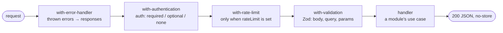

# API routes

How a route in `src/app/api/` is written. The short version is the "API
routes" rule in [`AGENTS.md`](../../AGENTS.md).

## Layout

Routes are grouped with Next route groups — folders in `(parentheses)` that
organise the files without changing any URL:

```
src/app/api/
├── [[...slug]]/              JSON 404 for unknown /api paths
└── v1/
    ├── (account)/            the signed-in user: me, preferences, onboarding, referrals
    ├── (jobs)/               jobs (+ jobs/[jobId]/bookmark), job-fields, job-titles
    ├── (public)/             open to anyone: feedback, talent
    └── (integrations)/       called by other systems: webhooks/clerk
```

Each response shape is a contract in `src/shared/contracts/` (see
[`../frontend/DATA_FETCHING.md`](../frontend/DATA_FETCHING.md)).

## A route

```ts
export const dynamic = "force-dynamic";

export const PUT = withMiddlewares(
  { label: "preferences.update", auth: "required", body: jobPreferenceSchema },
  async ({ user, body }): Promise<PreferencesSaveResult> => {
    const result = await getPreferencesModule().update.execute(user.id, body);
    if (result.ok) revalidatePath("/dashboard", "layout");
    return result;
  },
);
```

`withMiddlewares(options, handler)` (`src/backend/shared/http/middlewares/`)
wraps the handler in the middlewares every route shares, outer to inner:



| Option | Does |
|---|---|
| `label` | Names the route in logs (`"preferences.update"`). |
| `auth` | `required`: no user → 401 before the handler. `optional`: the handler gets the user or null. `none` (default): nobody is looked up. The user id always comes from the session, never the request. |
| `rateLimit` | A policy name from `src/backend/shared/rate-limit/policies.ts` (`"feedback"`). Over the limit → 429 `rate-limited` with `Retry-After`; allowed calls carry `RateLimit-*` headers. Runs after authentication (so it can count the user) and before validation (so junk counts too). Guide: [`RATE_LIMIT.md`](RATE_LIMIT.md). |
| `body` / `query` / `params` | Zod schemas. A mismatch is a 400 naming the field; the handler gets the parsed, typed value. A body must be JSON (415 otherwise) — which also stops other sites posting with the visitor's cookies. |

The handler returns plain data (sent as 200 JSON, never cached) or a
`Response` built with `json(data, { status })` from `respond.ts`.

## Errors

Throw, don't build a response. The exceptions live in
`src/backend/shared/exceptions/` — `base/` (`BaseError`) and `types/`, one
file each — and aren't tied to HTTP: a use case or a repository can throw
them too.

| Throw | Status | Code |
|---|---|---|
| `ValidationError` | 400 | `validation` |
| `UnauthorizedError` | 401 | `unauthorized` |
| `ForbiddenError` | 403 | `forbidden` |
| `NotFoundError` | 404 | `not-found` |
| `UnsupportedMediaTypeError` | 415 | `unsupported-media-type` |
| `TooManyRequestsError` | 429 | `rate-limited` |
| `InternalServerError` | 500 | `internal` |
| `ServiceUnavailableError` | 503 | `service-unavailable` |

The error handler answers `{ error, code, detail? }`:

- `code` and the message in `error` come from `src/shared/errors/error-codes.ts`
  — the one list both sides use, so the frontend shows the same words the
  backend sent.
- `detail` is the developer note passed to the exception
  (`new NotFoundError("Not a setup step")`, the fields Zod rejected). Users
  never see it.

Anything else that's thrown is logged with the route's label and answered as
`service-unavailable` (503) — no paths, stack or database detail reach the
client. 503, not 500, because the frontend reads it as "couldn't tell", never
as "signed out". A failed user lookup is also a 503, never a 401: a 401 sends
the browser to sign in, which for a signed-in user is a redirect loop.

## Schemas

A module's request schemas live in its `validation/` folder, one file per
schema named after it (e.g.
`src/backend/modules/preferences/validation/job-preference-schema.ts`), tied to
the shared contract so the two can't drift:

```ts
export const jobPreferenceSchema = z.object({ … }) satisfies z.ZodType<JobPreferences>;
```

Schemas check *shape*. The rules (MENA countries only, catalogue titles, …)
stay in the module's use case.

## Integrations

A route called by another system is still a thin adapter: its logic belongs
to the module that owns the data. `POST /api/v1/webhooks/clerk` only calls
`getAuthModule().syncUser.execute(request)`; the auth module verifies the
signature (`ClerkIdentityWebhook`, behind the `IdentityWebhook` port) and
applies the change (`SyncUserUseCase`). The route file stays under
`src/app/api/` only because that's where Next routes URLs from.
