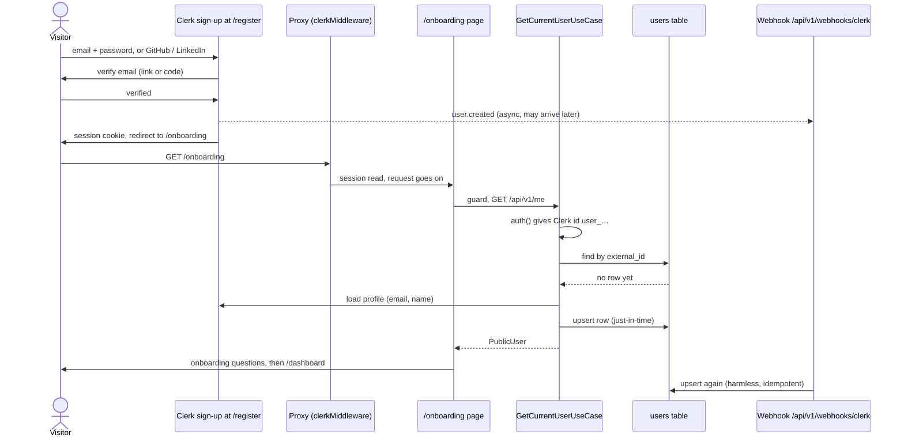
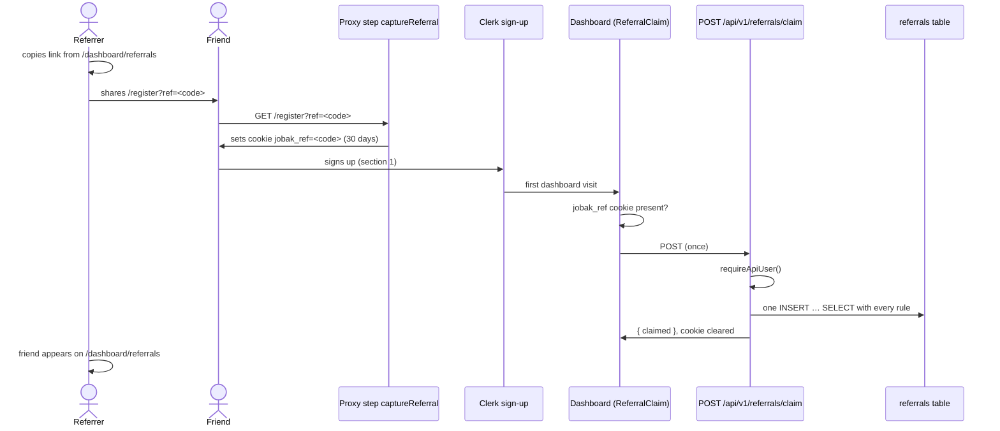

# Auth: the full cycle

How someone gets an account, how every request finds out who they are, how
referrals ride on top of that, and how to switch all of it off for local work.

Read this first. [`PROXY.md`](PROXY.md) covers the request pipeline in more
depth.

## The three ideas

1. **Clerk owns identity.** Sign-up, sign-in, passwords, email verification,
   GitHub and LinkedIn sign-in, sessions: all Clerk. We never see a password.
2. **Our `users` table owns the data.** Every preference, match, saved key and
   referral hangs off `users.id`. A row links to its Clerk account through
   `users.external_id` (`user_…` for Clerk, `local:owner` with auth off).
3. **The page or route handler is the gate, not the proxy.** Server code calls
   `requireUser()` (pages) or `requireApiUser()` (API routes). The proxy only
   reads the session so those calls work. It protects nothing.

## Where things live

| Piece | File | Job |
|---|---|---|
| Auth switch | `src/backend/modules/auth/infrastructure/config/auth-config.ts` | `isAuthEnabled()`, `getClerkKeys()`, the startup warning |
| Composition root | `src/backend/modules/auth/composition.ts` | Picks Clerk or the local owner, once per mode |
| Identity providers | `src/backend/modules/auth/infrastructure/providers/` | `ClerkIdentityProvider` / `LocalIdentityProvider` |
| "Who is this?" | `src/backend/modules/auth/application/use-cases/get-current-user.use-case.ts` | Session → `users` row, creating it on first sight |
| Gate for pages | `src/backend/modules/auth/interface/session.ts` | `requireUser()`, `getCurrentUser()` |
| Gate for API routes | `src/backend/modules/auth/interface/api.ts` | `requireApiUser()`, `getApiUser()` |
| "Who is this, onboarded?" over HTTP | `src/app/api/v1/(account)/me/route.ts`, `src/backend/modules/account/` | `GET /api/v1/me`: what the dashboard layout reads (contract: `src/shared/contracts/account.ts`) |
| Session in the proxy | `src/backend/shared/proxy/auth-session.ts` | `clerkMiddleware()`, or nothing with auth off |
| Sign-in / sign-up pages | `src/app/(auth)/` | Clerk's `<SignIn />` / `<SignUp />` at `/login`, `/register` |
| Clerk on the client | `src/app/layout.tsx`, `src/frontend/providers/auth-mode-provider.tsx` | `ClerkProvider` only with auth on; `useAuthEnabled()` |
| Keeping `users` in sync | `src/app/api/v1/(integrations)/webhooks/clerk/route.ts` | Clerk's `user.updated` / `user.deleted` |
| Page URLs | `src/shared/routes.ts` | `SIGN_IN_HREF` (`/login`), `SIGN_UP_HREF` (`/register`), … |

## 1. Sign-up, start to dashboard



What to notice:

- **The row is created on the first request, not by the webhook.** Webhooks are
  asynchronous and can lag, so `GetCurrentUserUseCase` creates the `users` row
  the first time it sees a new Clerk id. The webhook only keeps names and
  emails fresh and handles deletion.
- **Where people land.** `ClerkProvider` in `src/app/layout.tsx` sends a new
  account to `/onboarding` and a returning one to `/dashboard`. If Clerk sent
  them to sign in from a specific page, they go back there instead.
- **Onboarding is required.** The dashboard layout sends anyone who hasn't
  finished it to `/onboarding` (see "The dashboard layout asks over HTTP" below).

## 2. Every request after that

```
request
  └─ proxy: clerkMiddleware() reads the session cookie (no network call)
      └─ page or route handler
          ├─ page:      requireUser()      → user, or redirect to /login
          └─ API route: requireApiUser()   → user, or a 401 JSON response
```

Both go through the same `GetCurrentUserUseCase`: Clerk id → one indexed lookup
on `users.external_id`. The lookup is cached per render, so several components
asking "who is this?" cost one query.

**Failure is not the same as signed out.** If the database can't be reached,
`requireUser()` throws `UserLookupError` and the page shows an error with
Retry. It doesn't redirect to `/login`. The user *is* signed in with Clerk, so
`/login` would bounce them straight back, in an endless loop.
`getCurrentUser()`, used for cosmetic things like "Sign in" vs "Dashboard" in
the nav, returns `null` on failure instead, so a database blip can't take the
homepage down.

Write a new protected page or route like this:

```ts
// page / server action
const user = await requireUser();          // never check getCurrentUser() by hand

// API route
const { user, response } = await requireApiUser();
if (!user) return response;                // 401
```

Then scope every query by `user.id`. Authorization lives in the repository
queries, not in database row-level security.

### The dashboard layout asks over HTTP

The frontend doesn't import backend code for this. `(protected)/layout.tsx`
asks the backend over HTTP:

```
(protected)/layout.tsx
  └─ resolveDashboardAccess()        frontend/lib/api/guards/dashboard-access.ts
      └─ serverFetch()               frontend/lib/api/server-fetch.ts
          └─ GET /api/v1/me          forwards the visitor's cookie header
              └─ account module      backend/modules/account: auth + preferences
```

`serverFetch()` is the frontend's only way to call the backend from the
server. It calls `API_BASE_URL` when that is set, otherwise this app's own
origin, which is where the API routes live today. Moving the backend to
another service means setting `API_BASE_URL` and, for a different domain,
switching the auth it forwards from cookies to a bearer token. Both changes
are in that one file.

The response is the contract in `src/shared/contracts/account.ts`:

| Status | Meaning | The layout… |
|---|---|---|
| 200 `{ user, onboarded }` | signed in | shows the dashboard, or redirects to `/onboarding` if `onboarded` is false |
| 401 | nobody is signed in | redirects to `/login` |
| 503 | couldn't tell (database) | shows the retry screen, never a redirect |

401 and 503 must stay different, for the same loop reason as above.

## 3. Keeping `users` in step with Clerk

`POST /api/v1/webhooks/clerk` handles `user.created` / `user.updated` (upsert
the name and email) and `user.deleted` (delete the row; preferences, matches,
saved keys and referrals cascade). The Clerk signature proves the request is
genuine (`CLERK_WEBHOOK_SIGNING_SECRET`), so the route has no session check and
must never have one. Setup steps are in
[`PRE_PRODUCTION.md`](../general/PRE_PRODUCTION.md#clerk-auth-added-2026-11-07).

## 4. Referrals: riding on the same cycle

Every account has a referral code: the first 10 hex characters of `users.id`.
The database generates it (the `users.referral_code` column, `019_referrals.sql`),
and `referralCodeFor()` in the app computes the same value. A referral link is
`/register?ref=<code>`.



Why each part is there:

- **A cookie, not the URL.** Sign-up isn't one request. It spans Clerk's own
  steps and, for GitHub or LinkedIn, a round trip to another site, and the
  `?ref=` doesn't survive that. The proxy step `captureReferral`
  (`src/backend/shared/proxy/referral-capture.ts`) saves it in
  `jobak_ref`. The cookie name lives in `src/shared/referral/referral-cookie.ts`,
  because the frontend checks for it too. An invalid code is ignored, and a
  newer link replaces an older one.
- **Claimed after sign-up, not during.** The claim needs the new `users.id`,
  which only exists after section 1. `ReferralClaim`, in the dashboard shell,
  posts once when it sees the cookie.
- **The rules are in one SQL statement** (`PgReferralRepository.claim`), so two
  concurrent claims can't double-count:
  - the code belongs to a real user;
  - …who isn't the person signing up;
  - the new account is at most 7 days old (`REFERRAL_ATTRIBUTION_WINDOW_DAYS`),
    so an existing user can't be "referred" by opening a link months later;
  - each account is referred at most once.
- **The cookie is cleared after any answer except an error.** An ineligible
  claim stays ineligible. On a 500, or if the person is signed out, the cookie
  stays and the next dashboard visit tries again.

## 5. Running without auth

For working on the features without Clerk, set this in `.env.local`:

```bash
AUTH_ENABLED=false
```

Then `pnpm dev`. The database and encryption settings are still needed. See
the [README](../../README.md#-running-without-auth) for the full list and the
security warning.

What each piece does in each mode:

| Piece | `AUTH_ENABLED` unset / `true` | `AUTH_ENABLED=false` |
|---|---|---|
| Clerk keys | required: the app errors on the first request without them | not needed |
| Proxy | `clerkMiddleware()` reads the session, then the steps run | steps run, Clerk never called |
| Identity provider | `ClerkIdentityProvider` | `LocalIdentityProvider`: every request is the **local owner** (`external_id = local:owner`) |
| `requireUser()` | user, or redirect to `/login` | always the owner, never redirects |
| `/login`, `/register` | Clerk's forms | redirect to `/dashboard` (`(auth)/layout.tsx`) |
| Root layout | wrapped in `ClerkProvider` | no `ClerkProvider`; client code checks `useAuthEnabled()` before any Clerk hook |
| Webhook route | verifies and syncs | 404 |
| Referral cookie | set on `/register?ref=` | never set |
| Claim route | claims | 404 |
| `/dashboard/referrals` | your link and your list | explains referrals need accounts |
| Server log | — | a warning, once: every visitor is the owner |

Things to know when switching:

- **Only `false`, `0`, `no` or `off` turn it off.** Unset means on: an instance
  that wrongly asks for a sign-in is safer than one that wrongly skips it. A
  typo stops the app with an error rather than guessing.
- **Data stays with each identity.** The owner's data lives under
  `local:owner`. Switching auth on doesn't move it to a Clerk account, and
  switching back off makes it reachable again.
- **Build with the mode you run.** Prerendered pages decide at `next build`
  whether `ClerkProvider` wraps them. Set the same `AUTH_ENABLED` for the build
  as for the server, and for Docker, bake the mode into the image.
- **Switching while `pnpm dev` runs works.** The composition root rebuilds
  itself when the mode changes.
- **Never expose it.** With auth off, anyone who can reach the server is the
  owner, with the owner's data and API keys. Keep it on localhost or behind
  your own access control.

## FAQ

**Why doesn't the proxy protect `/dashboard`?** A check that far from the data
is easy to bypass with a route that forgets it. Next's own guidance is to check
in the data layer. The proxy only makes `auth()` work.

**A user exists in Clerk but not in `users`. Is that a bug?** No. Their row
appears on their first request (section 1). A missing `user.created` webhook
costs nothing.

**I deleted a user in Clerk and their data is still there.** The `user.deleted`
webhook isn't set up for this instance. See section 3.

**Where do I add something that must happen on every request?** As a proxy
step. See [`PROXY.md`](PROXY.md#adding-a-step).
