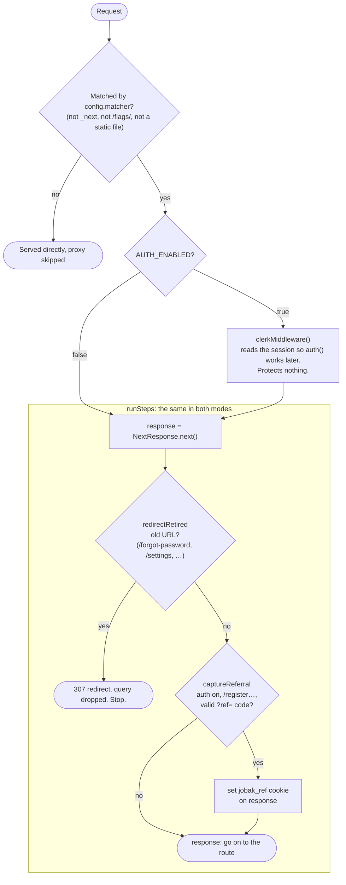

# Proxy (request pipeline)

Everything that happens to a request before it reaches a page or an API route.
Next 16 calls this file `proxy.ts` (it used to be `middleware.ts`). There is
exactly one, at `src/proxy.ts`.

```ts
export const proxy = withAuthSession(
  runSteps([
    redirectRetired,
    captureReferral,
  ]),
);
```

## The flow

The steps run in **both** auth modes. `AUTH_ENABLED` only decides whether Clerk
reads the session first.



Read `src/proxy.ts` from the inside out:

1. **`runSteps([...])`** runs once, when the file loads. It returns the
   *handler*. For each request the handler creates one `NextResponse.next()`
   and runs the steps in order.
2. **`withAuthSession(handler)`** also runs once. It returns the `proxy`
   function that Next calls on every request. With auth off, `proxy` calls the
   handler directly. With auth on, `proxy` calls Clerk, and Clerk calls the
   same handler. Clerk is built on the first request, not at load, so an
   instance without Clerk keys never touches it.

```
proxy (withAuthSession)         ← Next calls this on every request
 └─ Clerk, only if AUTH_ENABLED  ← session for auth() in pages and API routes
     └─ handler (runSteps)       ← always runs
         ├─ redirectRetired
         └─ captureReferral      ← skips itself when auth is off
```

Route protection is **not** done here. Pages and handlers call `requireUser()` /
`requireApiUser()` themselves.

## Steps

A step is a `ProxyStep` (`src/backend/shared/middleware/pipeline.ts`):

```ts
type ProxyStep = (request, response) => NextResponse | void | Promise<NextResponse | void>;
```

| The step… | Effect |
|---|---|
| returns a response (redirect, rewrite, 4xx) | The request ends here. Later steps don't run, and anything earlier steps set on `response` is dropped. |
| sets cookies or headers on `response` and returns nothing | Its changes are kept, and the next step runs. |
| returns nothing and touches nothing | Passes. The next step runs. |

| Step | File | Auth off | Auth on |
|---|---|---|---|
| `redirectRetired` | `shared/middleware/retired-paths.ts` | runs | runs |
| `captureReferral` | `shared/middleware/referral-capture.ts` | passes (no accounts, no referrals) | sets the `jobak_ref` cookie on `/register?ref=<code>` |

### Adding a step

1. Write a `ProxyStep` in `src/backend/shared/middleware/`.
2. List it in `runSteps([...])` in `src/proxy.ts`. Steps that end the request go
   first, so no work is done for a request that is about to leave.
3. If it should only run with auth on, check `isAuthEnabled()` inside the step,
   like `captureReferral` does.

Two import rules hold for `src/backend/shared/middleware/`. The proxy loads
these files, and a `server-only` import there breaks the proxy:

- From a module, import only its `domain/` files or its plain config, never its
  `index.ts`.
- Don't add an `index.ts` barrel. Import each file by its own path.

## Files

```
src/proxy.ts                                     the steps in order + config.matcher
src/backend/shared/middleware/
├── pipeline.ts          ProxyStep, runSteps, import rules
├── auth-session.ts      withAuthSession: Clerk or not
├── retired-paths.ts     redirectRetired + the old-URL table
└── referral-capture.ts  captureReferral
src/backend/shared/http/path.ts                  isUnder(): `/register/x` yes, `/registered` no
src/shared/routes.ts                             page URLs (SIGN_IN_HREF, …), used by both sides
src/shared/referral-cookie.ts                    REFERRAL_COOKIE, used by both sides
```

`config.matcher` must stay written out in `src/proxy.ts`. Next reads it at
build time and ignores anything imported or computed.
