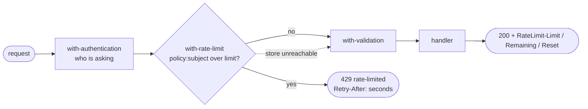

# Rate limits

How often something may happen, for every integration, in one place. The short
version is the "API routes" rule in [`AGENTS.md`](../../AGENTS.md).

## Two directions, one limiter

| Direction | Protects | How code uses it |
|---|---|---|
| **Our API** (inbound) | us: public forms, search, anything worth abusing | the route names a policy: `withMiddlewares({ rateLimit: "feedback", … })` |
| **Services we call** (outbound) | our quota at an AI provider or outside API | call it first: `await enforceRateLimit("openai", userId)` |

Both count against the same named policies and the same store.

```
src/backend/shared/rate-limit/
├── policies.ts             every integration's default limit, by name
├── config.ts               RATE_LIMIT_<NAME> overrides from the environment
├── rate-limiter.ts         counting and deciding (the store is injected)
├── pg-rate-limit.store.ts  the counts, in Postgres
└── index.ts                getRateLimiter(), enforceRateLimit()

src/backend/shared/http/middlewares/with-rate-limit.ts   the route middleware
src/backend/shared/types/rate-limit.ts                   RateLimitPolicy, RateLimitStore, …
```

## A request through it



- **Subject**, from the policy's `by`: `user` (the signed-in user, else the
  address; the default), `ip`, or `global` (everyone together).
- **Bucket key:** `<policy>:<subject>`, e.g. `feedback:user:<uuid>` or
  `talent:ip:203.0.113.7`.
- **Fails open:** if Postgres can't be reached, the call goes through and the
  failure is logged. The route would fail on the same database anyway.
- Junk requests count too: the limit runs before validation.

## The policies

From `policies.ts`:

| Policy | Default | Counts | Used by |
|---|---|---|---|
| `feedback` | 3 / minute | user, else address | `POST /api/v1/feedback` (the database's flood guard stays as a backstop) |
| `job-board` | 120 / minute | address | `GET /api/v1/job-board`, `GET /api/v1/job-board/[slug]` |
| `talent` | 60 / minute | address | `GET /api/v1/talent` |
| `job-titles` | 120 / minute | user | `GET /api/v1/job-titles` (search as you type) |
| `referrals.claim` | 10 / minute | user, else address | `POST /api/v1/referrals/claim` |
| `ai-settings.key` | 10 / minute | user | `PUT /api/v1/ai-settings/key` (each try calls the provider) |
| `ai-tools.cover-letter` | 6 / minute | user | `POST /api/v1/ai-tools/cover-letter` (each run is a full AI call) |
| `groq`, `gemini`, `openai`, `anthropic` | 20, 8, 30, 30 / minute | the user (outbound, keyed by user id) | every AI call, from the AI client factory ([AI_PROVIDERS.md](AI_PROVIDERS.md)) |
| `skills-github` | 60 / minute | everyone (outbound, key `global`) | every skill file read from GitHub on a cache miss ([COVER_LETTER.md](../ai-tools/COVER_LETTER.md#use-in-your-own-ai)) |

Not limited on purpose: the Clerk webhook (Clerk retries, and a refused event
would leave a user unsynced) and the signed-in reads and writes. Opt a route
in when it's worth abusing.

## Changing a limit per environment

Every policy reads `RATE_LIMIT_<NAME>` (upper case, dots and dashes as `_`):

```bash
RATE_LIMIT_FEEDBACK=10/1m          # 10 per minute
RATE_LIMIT_JOB_TITLES=300/1m
RATE_LIMIT_REFERRALS_CLAIM=5/10s   # windows: s, m, h
RATE_LIMIT_TALENT=off              # switched off here (local dev, a load test)
```

An override that doesn't parse is logged and ignored, so a typo never quietly
removes a limit.

## Adding an integration

**A route:** add a policy, then name it on the route.

```ts
// policies.ts
"jobs.bookmark": { limit: 60, windowSeconds: 60, by: "user" },

// the route
withMiddlewares({ label: "jobs.bookmark", auth: "required", rateLimit: "jobs.bookmark", … })
```

**A service we call:** name the policy after the service, set it from the
service's documented quota with some headroom, and count before each call.
Choose the key by how the service bills: per user when each user brings their
own key, `"all"` for one shared app key.

```ts
// policies.ts
openai: { limit: 500, windowSeconds: 60 },

// the client
await enforceRateLimit("openai", userId); // throws TooManyRequestsError (429) when over
const response = await fetch("https://api.openai.com/…");
```

## The store

Postgres, so a limit means the same on every server instance and survives
deploys: `rate_limits` and the `consume_rate_limit` / `sweep_rate_limits`
functions from [`db/supabase/015_rate_limits.sql`](../../db/supabase/015_rate_limits.sql)
(read its header). Each call is one atomic upsert. A fixed window, so across a
window boundary a caller can briefly get up to twice the limit, which is fine
for bounding abuse. One call in 200 also sweeps buckets that have been idle for
a day, so no cron job is needed.

Another store (Redis, say) only has to implement `RateLimitStore` and be
passed in `index.ts`.

## Server-side fetches

A page that calls a rate-limited endpoint through `serverFetch` (e.g.
`/talent`) still counts the **visitor**: `serverFetch` forwards their
`x-forwarded-for`. Without it, every page view would share the server's own
bucket.
