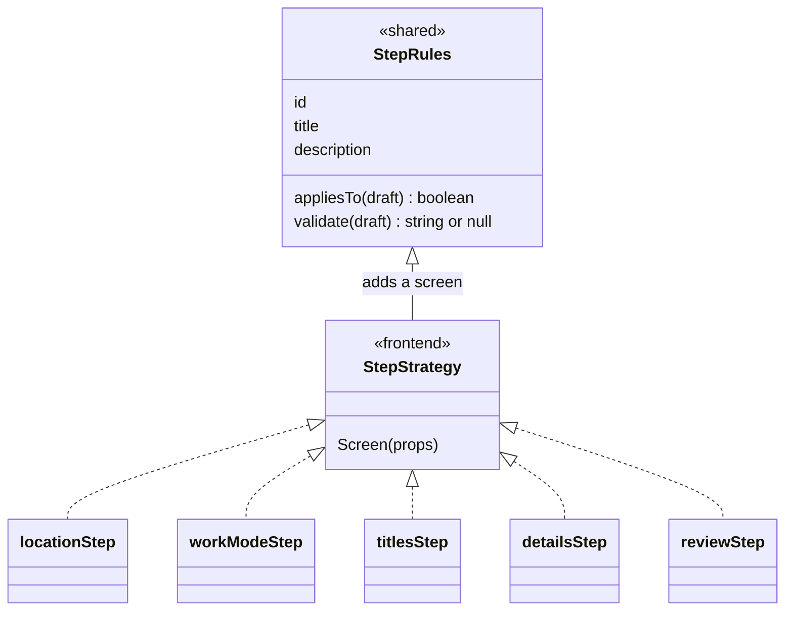
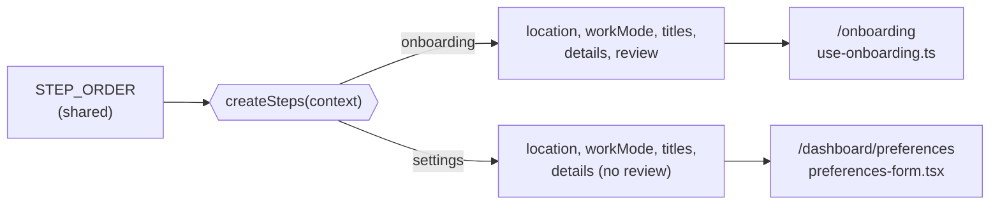
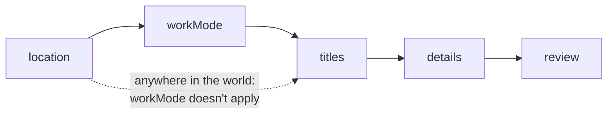
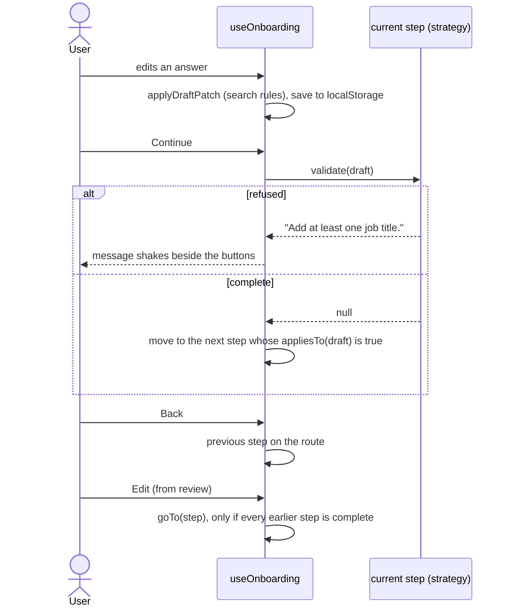
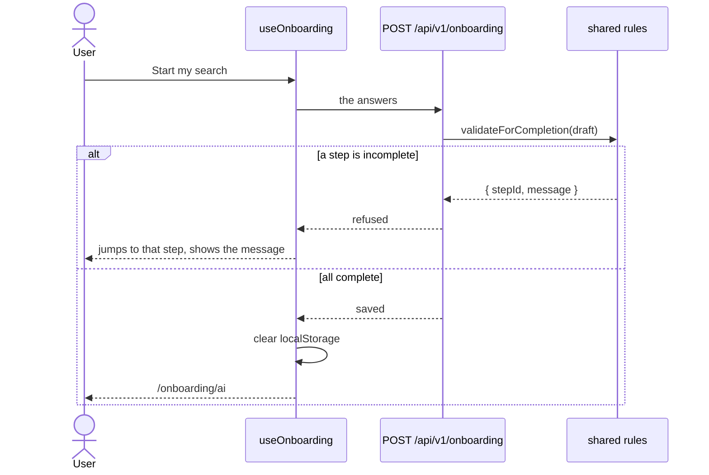
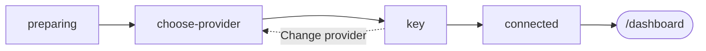

# Onboarding: how the steps work

The job questions at `/onboarding` are built with two patterns:

- **Strategy:** every step is an object with the same shape. The flow treats
  them all alike and never has a `switch` on the step.
- **Factory:** one function builds the list of steps for a screen. Nobody
  imports the step files directly.

Code is laid out as **vertical slices** under one orchestrator: everything
for a step lives in that step's folder.

```
src/frontend/modules/onboarding/questions/
├── orchestrator/              runs the flow
│   ├── onboarding-flow.tsx      the layout
│   ├── use-onboarding.ts        state: current step, answers, next / back / goTo / finish
│   ├── step-factory.ts          createSteps(context), createStep(id)
│   ├── step-strategy.ts         the StepStrategy interface
│   │   (the final submit is src/frontend/modules/onboarding/api/ — saveOnboarding / useSaveOnboarding)
│   ├── saved-progress.ts        unsaved answers in localStorage
│   ├── draft.ts                 applyDraftPatch
│   └── segmented-progress.tsx   the progress bar
├── steps/
│   ├── location/                location-step.ts, location-screen.tsx, country-option.tsx
│   ├── work-mode/               work-mode-step.ts, work-mode-screen.tsx
│   ├── titles/                  titles-step.ts, titles-screen.tsx, title-search.tsx, tag-input.tsx
│   ├── details/                 details-step.ts, details-screen.tsx
│   └── review/                  review-step.ts, review-screen.tsx
└── ui/                        option-card, rise-style, toggle (shared by several steps)

src/shared/onboarding/         the rules, mirrored per step (the backend runs them too)
├── step-rules.ts                the StepRules interface, StepId
└── steps/
    ├── index.ts                 STEP_ORDER, routeFor, validateForCompletion
    └── <step>/rules.ts          one per step, same names as the frontend folders
```

## 1. The pieces



Each step answers two questions, about itself only:

| Step | `appliesTo` | `validate` refuses when… |
|---|---|---|
| location | always | no country and not "anywhere" |
| workMode | **not** "anywhere in the world" | no work mode picked |
| titles | always | no job title |
| details | always | never (both fields optional) |
| review | always | never |

A step never says which step comes next. The order is one list,
`STEP_ORDER` in `src/shared/onboarding/steps/index.ts`.

Where each part lives:

| Part | File |
|---|---|
| Rules (shared with the backend) | `src/shared/onboarding/steps/<step>/rules.ts` |
| Strategy = rules + screen | `questions/steps/<step>/<step>-step.ts` |
| The screen | `questions/steps/<step>/<step>-screen.tsx` |
| The factory | `questions/orchestrator/step-factory.ts` |
| The state (current step, answers) | `questions/orchestrator/use-onboarding.ts` |
| The final submit | `src/frontend/modules/onboarding/api/onboarding.mutations.ts` (`useSaveOnboarding`) → `POST /api/v1/onboarding` |
| The layout | `questions/orchestrator/onboarding-flow.tsx` |

## 2. The factory



`createStep(id)` returns one step by id, which the Preferences page uses for
its active tab.

## 3. A run through the steps

The steps shown are the factory's list minus the ones whose `appliesTo` is
false, so the route changes with the answers:



What each button does (`use-onboarding.ts`):



## 4. Saving



The server runs the **same rules** as the browser (`validateForCompletion` in
`src/shared/onboarding/steps/index.ts`), so a hand-edited request can't save
answers the form would have refused.

**Refresh:** every edit and the current step are kept in `localStorage`
(`saved-progress.ts`), one entry per account. On load they're restored, but
never past a step that's still incomplete. The entry is removed once the save
succeeds.

## Adding a step

1. **Rules:** `src/shared/onboarding/steps/<step>/rules.ts` with `id`, `title`,
   `description`, `appliesTo` and `validate`. Add the id to `StepId` in
   `step-rules.ts`.
2. **Order:** put it in `STEP_ORDER` (`src/shared/onboarding/steps/index.ts`).
3. **Slice:** a folder `questions/steps/<step>/` with `<step>-screen.tsx` and
   `<step>-step.ts` exporting `{ ...<step>Rules, Screen }`, plus anything only
   this step uses.
4. **Factory:** register it in `STRATEGIES` in `orchestrator/step-factory.ts`.
5. **Per-step copy elsewhere:** TypeScript will point these out, because
   they're keyed by `StepId`:
   - the preview panel's headline (`HEADLINES` in `search-preview.tsx`);
   - the Preferences page's tab label and summary (`GROUP_LABEL`,
     `summaryOf` and `groupKey` in `preferences-form.tsx`).

The flow, the route, the progress bar and the server check pick the step up
from the list with no further changes.

## The AI step (`/onboarding/ai`)

The second onboarding, connecting the AI, is lighter: the same vertical-slice
folders, without the factory and strategies. Its four phases run in a fixed
order, so `ai-setup-flow.tsx` switches between them directly.

```
src/frontend/modules/onboarding/ai/
├── orchestrator/
│   ├── ai-setup-flow.tsx        state (phase, provider, key) and the layout
│   └── connection-panel.tsx     the right-hand panel
├── phases/
│   ├── preparing/               preparing-screen.tsx
│   ├── choose-provider/         choose-provider-screen.tsx
│   ├── key/                     key-screen.tsx, preview-verify.ts
│   └── connected/               connected-screen.tsx
└── providers.ts                 the providers' names, links and copy
```



- **preparing** runs the three setup steps one after another
  (`GET /api/v1/onboarding/setup-steps/[step]`, contract
  `src/shared/contracts/setup-steps.ts`) through TanStack Query, and shows
  their numbers as they arrive. A step that fails is shown as skipped and the
  setup carries on.
- **key** verification is still a design-stage stand-in (`preview-verify.ts`
  checks the format only and saves nothing).

The dashboard's Settings page reuses `ChooseScreen`, `KeyScreen`,
`ConnectionPanel` and `previewVerifyKey` from these folders.
